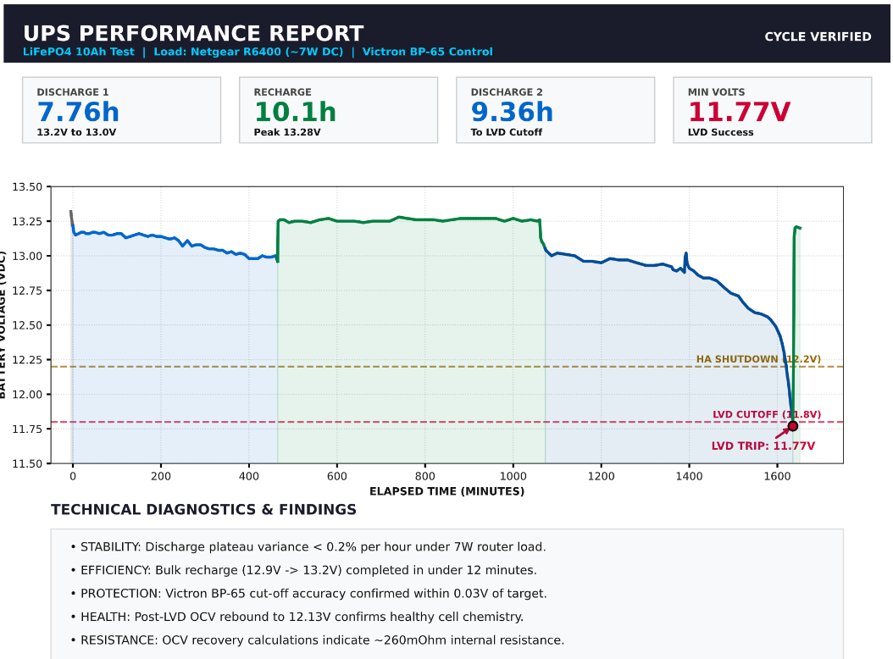
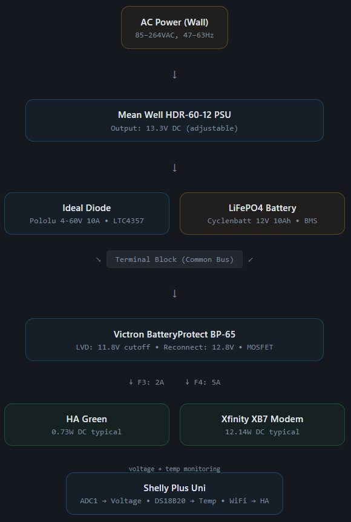
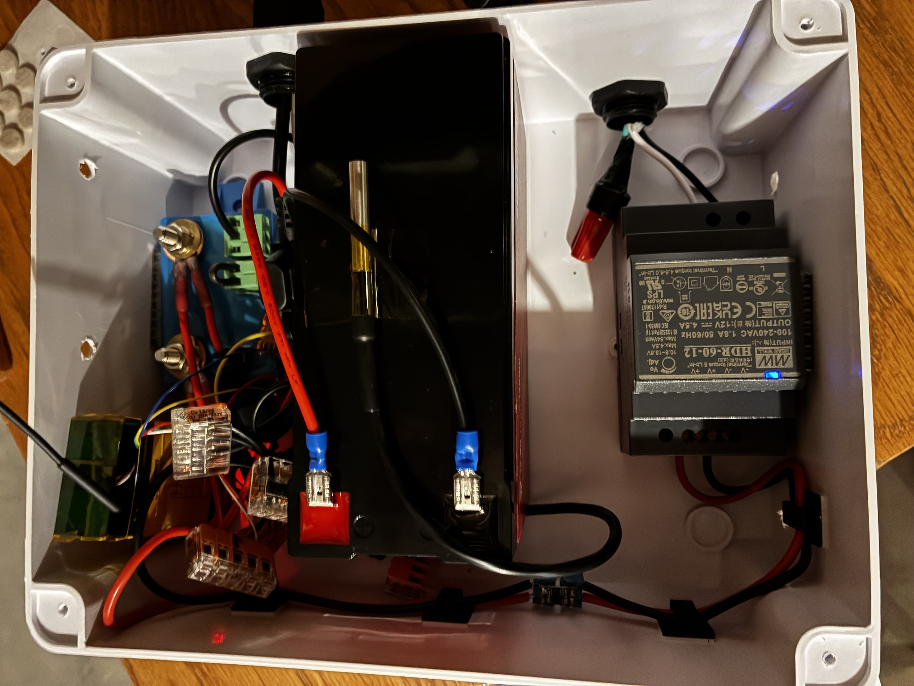
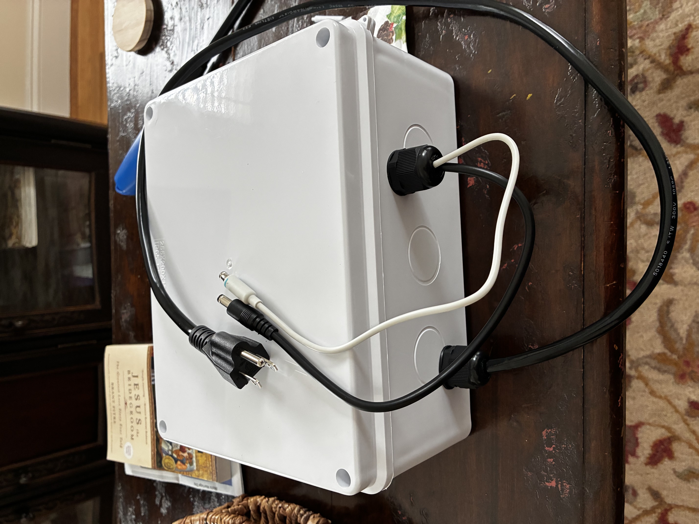

<div align="center">

# DIY LiFePO₄ UPS for a Home Assistant Host & Xfinity XB7 Modem

**12 V LiFePO₄ DC UPS · 18 V boost rail for the host · ESPHome coulomb-counting monitor · planned bench top-off charger**

[](LICENSE)
[](#current-status)
[](#test-history)
[](#monitor)
[](#key-specifications)
[](https://github.com/sponsors/wkcollis1-eng)

</div>

A 12 V LiFePO₄ DC uninterruptible power supply. It keeps a Home Assistant host (ASRock N100DC-ITX) and an Xfinity XB7 cable modem running through grid outages, shuts the host down cleanly before the battery runs out, and recovers by itself when power returns. A Mean Well DIN-rail supply floats a 10 Ah pack through a MOSFET ideal diode. A Victron BatteryProtect provides the hardware low-voltage disconnect. An 18 V Pololu boost feeds the host. An ESPHome monitor on a purpose-built carrier PCB coulomb-counts every outage into Home Assistant.

The project was built in early 2026 around a Home Assistant Green, which ran directly on the 12 V bus. That host has been retired. The HA host is now the N100DC, which has run from this UPS since 2026-08-29; its 19 V ±10 % input window [S, ASRock N100DC-ITX manual] is why the boost exists. Documents dated before August 2026 describe the HA Green build; [Documentation](#documentation) says which ones are current.

Figures in this README carry the repository's provenance tags: **[M]** measured, **[S]** specification or prior document, **[D]** derived from [M]/[S] by stated arithmetic, **[I]** inferred and not yet tested, with the observation that would falsify it.

> **Honest context:** An $85 APC BE600M1 provides comparable backup for a modem and a small host. The case for building this instead (no inverter stage, sub-millisecond DC switchover by design, LiFePO₄ chemistry, direct Home Assistant telemetry) is in [design-rationale.md](docs/design-rationale.md). That document and its 10-year cost comparison were written for the March 2026 HA Green build and do not include the boost or the monitor PCB. Build this if those tradeoffs matter to you, and read [Current status](#current-status) first.

---

## ⚠️ Safety Warning

> [!CAUTION]
> **This project involves lithium batteries and AC mains voltage.** Improper handling can cause fire, electric shock, or equipment damage.

- ✅ **Disconnect AC power** before any work inside the enclosure
- ✅ Use appropriate **fusing** on battery connections
- ✅ Never charge LiFePO4 below **0°C (32°F)**
- ✅ Keep a **Class B or ABC fire extinguisher** accessible
- ✅ Follow the boost's energization order, OP-1 in [boost-subsystem-design.md](UPS-Monitor/boost-subsystem-design.md): *battery last-off, first-on; host barrel jack last-on, first-off*. This keeps the host off every connect transient.
- ✅ Review [docs/safety.md](docs/safety.md) before building

**Disclaimer:** Information provided for educational purposes only. Build at your own risk.

---

## Current Status

*As of 2026-10-16.*

| Area | State |
| :--- | :--- |
| Service | In service. Carries the XB7, and since 2026-08-29 the N100DC host |
| Protection ladder | Run end-to-end to the hardware LVD for the first time on 2026-09-15, including survival sleep; recovered with no intervention [M] |
| Capacity | **Well below its May 2026 value, by more than the test conditions can explain; cause not yet identified** (below) |
| Unattended recovery | Guaranteed only for outages that reach LVD, until the boost EN shed is fitted (below) |
| Monitor | UPS-Monitor-THT Rev 1 PCB, ESPHome firmware V1.20 (deployed 2026-09-16) |
| Top-off charger | Pre-build design, rev 0.10. Board not fabricated, firmware not validated |

> [!IMPORTANT]
> **Capacity shortfall.** On 2026-09-15 the pack delivered **2.5331 Ah / 31.821 Wh** from onset to LVD [M, firmware coulomb counter; independent HA-side integration agrees to +0.95 %]. Over the same voltage span at the same load, it delivered **42.4 % less charge than on 2026-09-01**, fourteen days earlier [D, [09-15 report](reports/UPS_Report_2026-09-15_Full_Discharge_Survival_Test.md) §4.3, n = 1 run each]. Measured LVD to LVD, it is 39.4 % below the 4.179 Ah of 2026-05-06 [D, same report]. Rate effects, Peukert, float droop and temperature together account for under 10 % of the LVD-to-LVD gap and none of the load-matched gap [D, §4.4].
>
> The leading candidate is cell imbalance or one weak cell [I, §4.5]. The direct falsifier, per-cell voltage at the end of discharge, cannot be measured: the pack is sealed and has no balance taps. Open Items 14a and 16 are the non-invasive substitutes ([Open work](#open-work)).
>
> **Every runtime and capacity figure from before September 2026, including the "~3.6 h / 4.18 Ah" this README used to quote, describes a pack and a load that no longer exist.**

### Unattended-recovery gap

The boost takes its input from the BP-65 load output, and its EN pin is not yet driven. `hassio.host_shutdown` therefore leaves the N100DC in S5 soft-off with 18 V still applied. Its BIOS setting *Restore on AC/Power Loss = Power On* acts only on a power cycle at the jack. **If AC returns after the graceful shutdown but before the pack reaches LVD, the host stays off until someone presses its power button** [D, [08-31 report](reports/UPS_Report_2026-08-31_Boost_Integration.md) §3].

Outages that reach LVD do recover, because the BP-65 collapses the rail. On 2026-09-15 the host booted with no button press after AC was restored [M]. The 09-15 report's Open Item 1 records why one operator-timed restoration does not fully establish the BIOS behaviour.

The fix is designed and not built: an EN shed from the monitor through an N-FET, latched low for the rest of the outage and released only on confirmed AC return. In [BOOST-DS-r1](UPS-Monitor/boost-subsystem-design.md) this is design rule DR-1 and procedure OP-2.

---

## System Overview

```
 120 VAC ─► Mean Well HDR-60-12 ─► MOSFET ideal diode ─┐
            13.3 V float, 54 W / 4.5 A                 │
                                                       ▼
            ┌──────────────────────── 12 V bus (Wago) ──────────────────────┐
            │                                                               │
     INA260 (battery branch, + = charging)                       Victron BP-65 LVD
            │                                               off 11.80 V / on 12.80 V + 30 s
   Cyclenbatt 12 V 10 Ah LiFePO₄                                            │
   (sealed, internal BMS)                                ┌──────────────────┴─────────────────┐
            │                                            ▼                                    ▼
   UPS-Monitor-THT  ◄── TB1 → F1 1 A                Xfinity XB7                    Pololu U3V70A boost
   XIAO ESP32-C3 · D24V7F3 · DS18B20                (12 V direct)                  18.0 V · 5 A-fused lead
            │ Wi-Fi                                                                           ▼
            └──────────────────────────► Home Assistant ◄──────────────────── ASRock N100DC-ITX (HA host)
```

When AC is present, the PSU holds the bus at float and the pack sits at equilibrium. When AC fails, the ideal diode blocks and the pack carries the loads. The monitor is fed upstream of the BP-65, so it stays powered after the LVD trip and can run survival sleep. It measures the battery branch: the INA260 sits between the Wago bus (VIN+) and Battery+ (VIN−), and the metered current runs on 16 AWG through the breakout's own terminals, not through PCB copper [S, `ups-monitor.yaml` header].

---

## Key Specifications

| Parameter | Value | Basis |
| :--- | :--- | :--- |
| PSU | Mean Well HDR-60-12, 54 W / 4.5 A, trimmed to 13.3 V and lacquered | [S, HDR-60 datasheet] |
| Float at the bus, boost era | 13.1970 V mean (13.2325 V before the boost), 23.3 mV above the 13.15 V on-battery threshold; 0 false on-battery events in 26,413 samples | [M, 08-31 report] |
| Battery | Cyclenbatt 12 V 10 Ah LiFePO₄, 4S, sealed: no balance taps, no BMS telemetry | [S, nameplate]; sealed [M, owner] |
| Usable capacity | **2.5331 Ah / 31.821 Wh**, onset to LVD, 2026-09-15. Under investigation | [M] |
| LVD | Victron BP-65: disconnect 11.80 V after its delay, reconnect 12.80 V after 30 s. Trips seen: 11.77 V (2026-03-26); last telemetry before the 2026-09-15 trip 11.675 V | [S, BP-65 manual]; trips [M] |
| Load on battery | 2.089 A / 26.80 W steady, 2.533 A / 32.48 W peak (host + XB7 + monitor) | [M, 2026-08-29 outage, n = 156] |
| Load after host shutdown | ~1.40 A (XB7 + monitor) | [M, 2026-09-15] |
| AC at the outlet | 30.554 W with the boost; 16.832 W before it | [M, 08-31 report] |
| Boost | Pololu U3V70A set to 18.0 V and lacquered; input from the BP-65 load output; EN not yet driven | [S, BOOST-DS-r1] |
| Host input window | 17.1–20.9 V (19 V ±10 %) | [S, ASRock N100DC-ITX manual] |
| Recharge | Limited by the PSU's 4.5 A constant-current limit: peak captured 4.4465 A, a lower bound | [S]; [M, 2026-09-15] |
| Switchover | No interruption seen by the XB7 or the host in the 2026-08-29, 09-01 or 09-15 outages. The <1 ms figure is the ideal diode's design value, not a measurement: 5 s telemetry cannot resolve it | [M]; <1 ms [S] |
| Monitor | UPS-Monitor-THT Rev 1: XIAO ESP32-C3, Adafruit INA260 (socketed), DS18B20, Pololu D24V7F3; ESPHome firmware V1.20 | — |
| Enclosure | LeMotech ABS, 9.6″ × 7.6″ × 4.5″; IP65 as sold, IP4X once vented | [S, [supplemental-analysis.md](docs/supplemental-analysis.md)] |
| Build cost | $223.88 for the March 2026 build; excludes the monitor PCB and the boost subsystem | [S, [bom.md](docs/bom.md)] |

---

## Operating Modes and Protection Ladder

Thresholds are the V1.20 firmware's substitutions [S, [`ups-monitor.yaml`](UPS-Monitor/ups-monitor.yaml)]. The Home Assistant side is the `ups_*_v3` automation chain in [home-assistant-config](https://github.com/wkcollis1-eng/home-assistant-config).

1. **AC present.** The PSU holds the bus at float through the ideal diode, and the pack sits at about 0 A. The 13.3 V ceiling keeps the bus inside what the loads tolerate, at the cost of holding the pack near 65 % SOC [S, 05-06 report §4.3]. That is why the [top-off charger](#planned-top-off-charger) is planned.
2. **AC fails.** The ideal diode blocks and the pack carries the loads with no interruption. `on_battery` sets when the bus falls below 13.15 V.
3. **Discharge phases.** The firmware tracks Settling, then Plateau (≥ 12.65 V), Knee (12.40–12.65 V) and Cliff (≤ 12.40 V). It counts Ah and Wh and estimates the runtime remaining.
4. **Graceful host shutdown.** Home Assistant calls `hassio.host_shutdown` on the first of three triggers, after a 30 s revalidation:
   - `cliff_imminent`: EMA voltage slope below −10 mV/min, with V < 12.65 V and the pack discharging, held 180 s;
   - `voltage_warning`: 12.40 V;
   - a runtime estimate under 8 min.

   The XB7 stays up.
5. **Hard fallback.** `voltage_critical` (12.20 V, held 10 s) calls the host shutdown with no revalidation, in case the graceful path has not completed.
6. **LVD.** The BP-65 opens at 11.80 V after its delay, dropping the XB7 and the boost. The monitor stays powered.
7. **Survival sleep.** When the load collapses at the trip (on battery, −0.30 A < I < +0.20 A), the monitor deep-sleeps in 120 s cycles with at most 60 s awake each, rather than draining the pack awake, and records each wake voltage in flash. It exits when V ≥ 13.0 V.
8. **AC returns.** The PSU recharges at its 4.5 A current limit and the BP-65 reconnects 30 s after the bus passes 12.80 V. The boost restarts, and the host powers on if it lost DC (see the [recovery gap](#unattended-recovery-gap)).

**What the record shows about the ladder:**

- **Graceful shutdown.** It first fired in May 2026, via `cliff_imminent`. In both boost-era runs, every attempt aborted at least once before one held [D, the firmware replayed on both runs' data, 09-15 report §6.1, n = 2; the 09-15 abort was also seen in HA, M]. The slope term's noise is sd 18.7–24.0 mV/min against a −10 mV/min threshold [M]. V1.20 raised the hold from 60 s to 180 s for this reason, and that change has not yet been exercised in an outage.
- **`voltage_critical` fallback.** It has never been the path that shut a running host down [M].
- **Host-down to LVD.** On 2026-09-15 this took 52 min 47 s at ~1.40 A, with the BP-65 as the only protection [M]. That margin was measured on a pack whose capacity is changing, so it does not set a threshold.

---

## Monitor

### Hardware: UPS-Monitor-THT Rev 1


- KiCad 10, 2-layer, 44 × 77 mm, drawn for OSH Park [S, `ups-monitor.yaml` header]. It replaced the SBB400 breadboard build.
- The Adafruit INA260 (#4226) breakout sits in socket U2. The metered current never touches PCB copper. The board's own supply runs from TB1 through F1 (1 A slow-blow) to a Pololu D24V7F3 3.3 V regulator.
- DS18B20 battery probe on TB2. I²C on GPIO6/GPIO7, 1-Wire on GPIO10.
- Files: [`UPS-Monitor-THT.kicad_pcb`](UPS-Monitor/UPS-Monitor-THT.kicad_pcb), Gerbers in [`UPS-Monitor-THT-Rev_1.zip`](UPS-Monitor/UPS-Monitor-THT-Rev_1.zip), and renders in [`UPS-Monitor/`](UPS-Monitor/).
- The U2 footprint also accepts an INA228 breakout. The firmware is INA260-specific, and an INA228 remaps socket pin 5, so do not substitute one without re-validating.

### Firmware: `ups-monitor.yaml` V1.20

[`UPS-Monitor/ups-monitor.yaml`](UPS-Monitor/ups-monitor.yaml) is the deployed build, byte-identical to the file on the HA host. Credentials resolve through `!secret`; no `secrets.yaml` is in this repository. Every revision is recorded in its header changelog.

What the firmware does:
- coulomb-counts Ah and Wh per outage and over the pack's life;
- runs the discharge-phase state machine and the `cliff_imminent` slope detector;
- estimates runtime remaining;
- estimates internal resistance at outage onset;
- keeps survival-sleep records in NVS;
- watches for stale INA260 data.

V1.20 (2026-09-16) changes:
- V, I and P are now published from one paired read. Before, they ran on free-running clocks, with a V-to-I skew re-drawn on every boot (~1.29 s on the 09-15 boot [M, 09-15 report §10.3]);
- a windowed Apparent-Ri gate;
- `cliff_imminent` hold raised from 60 s to 180 s;
- outage duration now stops at AC return;
- hysteresis on the fully-charged detector.

The survival-sleep design is documented in [`UPS_SurvivalSleep_Design_Summary_v12.md`](UPS-Monitor/UPS_SurvivalSleep_Design_Summary_v12.md). That document tracks the firmware through V1.14, and its currency note lists what changed after.

> [!NOTE]
> **Known issue: the `INA260 Alert` entity cannot fire.** The Rev 1 PCB routes the INA260's ALERT (socket pin 5, R2 pull-up) to XIAO D3 = GPIO5. The firmware, and its header pin map, read GPIO3 (D1), which is unconnected [M, KiCad pad positions; owner-confirmed 2026-10-01]. Nothing depends on it: the firmware arms no alert condition and no automation reads the entity. A one-pin fix is written and held until it can be bench-tested.

---

## Test History

| Date | Event | Load | Result | Source |
| :--- | :--- | :--- | :--- | :--- |
| 2026-03-25/26 | Commissioning: two discharges on a substitute load (Netgear R6400) | ~7 W DC | BP-65 tripped at 11.77 V [M, Shelly ADC] | [commissioning.md](docs/commissioning.md) |
| 2026-03-26 → 04-05 | Commissioning window and relocation to the permanent site | HA Green + XB7 | Stable float | [04-05 report](reports/UPS_Report_2026-04-05.md) |
| 2026-05-06 | Outage to LVD; first INA260 coulomb count; first graceful shutdown | HA Green + XB7, 1.18 A / 14.9 W | **4.179 Ah / 53.271 Wh** [M]; ~213 min AC-fail to LVD [D, 10:25:20 → ~13:58:30 UTC] | [05-06 report](reports/UPS_Report_2026-05-06.md) |
| 2026-06-18 | Partial outage; AC restored at 12.452 V, before any cliff | 1.186 A / 15.18 W | 3.62 Ah / 46.34 Wh in 183.3 min [M]; no protection automation fired | [06-18 report](reports/UPS_Report_2026-06-18.md) |
| 2026-08-29 | First outage after the boost was fitted | 2.089 A / 26.80 W | XB7 and host held through switchover [M] | [08-31 report](reports/UPS_Report_2026-08-31_Boost_Integration.md) |
| 2026-09-01 | Deliberate test, stopped at 12.565 V | host + XB7 | 1.833 Ah / 23.369 Wh in 54 min [M] | [08-31 report](reports/UPS_Report_2026-08-31_Boost_Integration.md) |
| 2026-09-15 | **Full discharge to LVD; first survival sleep; recharge** (firmware 1.19) | ~2.05 A, falling to ~1.40 A after the host shut down | **2.5331 Ah / 31.821 Wh** in 1 h 30 m 08 s onset to LVD [M] | [09-15 report](reports/UPS_Report_2026-09-15_Full_Discharge_Survival_Test.md), [data](data/2026-09-15_full_discharge_survival_test/README.md) |

All runs are on the same pack. May and June were on the pre-boost load (~1.18 A); August onward on the N100DC load. None of the pre-September figures predicts the present pack.

### 2026-09-15: what it established

- **Full ladder to the hardware LVD.** The run went Plateau → Knee (09:41:48) → Cliff (10:32:50) → BP-65 trip (10:47:18). The cliff lasted 14 min 28 s [M].
- **Survival sleep, first real exercise.** It ran 5 sleep/wake cycles over a ~12 min 51 s blackout. Wake voltage rose from 11.9275 to 11.9762 V, consistent with an unloaded pack relaxing. It exited cleanly, and the system recovered unattended [M].
- **The recharge is PSU-limited, not pack-limited.** The captured peak, 4.4465 A, is 98.8 % of the HDR-60-12's 4.5 A rating [D, 4.4465 ÷ 4.5]. The bus re-crossed 13.15 V 39 min 25 s after charge current was first seen [D, 11:00:13.67 → 11:39:39]. At the report cutoff, 51 min 49 s in [D, 11:00:13.67 → 11:52:03], 0.792 A was still flowing [M]. A recharge to termination has not been observed (Open Item 16).
- **Data caveats.** The InfluxDB export covers 37.5 of the ~90 discharge minutes, and it holds one stale sample per series written on recorder restart. Read the [reproduction guide](data/2026-09-15_full_discharge_survival_test/README.md) before re-analysing.

### Commissioning, March 2026



The March 25–26 commissioning ran two full discharges on a Netgear R6400 substitute load (~7 W DC), logged by the Shelly Plus Uni at 5 s intervals. The BP-65 tripped at **11.77 V** against its 11.80 V setting [M], and the pack recovered to float on AC return. The Shelly was replaced by the INA260 monitor in April 2026. Its voltage-profile capacity estimate (D3: 4.85 Ah / 62.5 Wh) was superseded by the May coulomb count and should not be used as a baseline.

---

## Open Work

In priority order, from the [09-15 report](reports/UPS_Report_2026-09-15_Full_Discharge_Survival_Test.md) §11 and the [08-31 report](reports/UPS_Report_2026-08-31_Boost_Integration.md) §7:

1. **Open Item 14a: repeat the full discharge at May's current.** Shut the host down before cutting AC, so the load is the XB7 and the monitor only (~1.2–1.4 A). Use the same 11.80 V endpoint and the same instrument as 2026-05-06. This is the decisive capacity test, and it is also the first outage to exercise V1.20's 180 s `cliff_imminent` hold.
2. **Open Item 16: coulomb-count one recharge to termination**, then compare it with the discharge count. This separates real fade from incomplete charge.
3. **Boost EN shed** (DR-1/OP-2) to close the [recovery gap](#unattended-recovery-gap), and the BOOST-DS-r1 §10 scope gate (V1–V5), which is still open.
4. **Build the top-off charger**, then run 14a before and after a top-balance hold.
5. **Fix the INA260 ALERT pin** once it can be bench-tested.

---

## Planned: Top-Off Charger

[`Top-Off-Charger/top-off-charger-design.md`](Top-Off-Charger/top-off-charger-design.md) is a pre-build design draft, rev 0.10, dated 2026-10-16.

The 13.3 V float never takes the cells to balancing voltage. The plan is to take the pack out of the UPS for each session, charge it to full on a Dylannet P20 at 5 A, and then hold it at 14.40 V on a Mean Well HDR-30-15 (worst case ≤ 3.64 A [D, design §4.1]). An ESPHome controller times the hold and logs the current tail.

- **Controller board.** Top Off Charger PCB rev 0.8: KiCad 10, 2-layer, 29.5 × 78 mm, for OSH Park. It carries a XIAO ESP32-C3, an Adafruit INA228 (#5832) with a 15 mΩ shunt, a Pololu #2814 MOSFET switch, a Pololu #5382 ideal diode, a D24V7F3 regulator, a status LED and a Kelvin ground for the INA228. DRC: 0 errors / 34 warnings / 0 unconnected [M]. **Not fabricated; Gerbers not exported** (O11).
- **Protection.** A protection ladder (L1–L8), firmware requirements (FW-1–FW-14) and acceptance tests (T0–T15). The design requires each session to end by itself within its time cap, and nothing to restart a charge after a reboot or an AC blip. None of it is tested yet.
- **Firmware.** [`firmware/top-off-charger.yaml`](Top-Off-Charger/firmware/top-off-charger.yaml) V0.2 is drafted and **not validated** (O4).
- **What it cannot do.** It cannot balance a pack whose BMS has no balancer, and nothing documents whether this one has one. The current tail at 14.40 V is the first direct look [I; falsifier: the logged current decays toward zero with no floor]. The success measure is Open Item 14a before and after. It does not serve Open Item 16, because the P20 does the bulk charge and counts nothing (O10).

---

## Assembly


*Elevation (top) and plan (bottom) views of the LeMotech junction box, interior dimensions in inches. This drawing and the block diagram below predate the boost and the THT monitor PCB.*






---

## Documentation

**Current**

| File | Contents |
| :--- | :--- |
| [reports/UPS_Report_2026-09-15_Full_Discharge_Survival_Test.md](reports/UPS_Report_2026-09-15_Full_Discharge_Survival_Test.md) | Full discharge to LVD, first survival sleep, recharge, capacity shortfall (r3) |
| [data/2026-09-15_full_discharge_survival_test/](data/2026-09-15_full_discharge_survival_test/README.md) | Raw series, logs, capture scripts and reproduction guide for that report |
| [reports/UPS_Report_2026-08-31_Boost_Integration.md](reports/UPS_Report_2026-08-31_Boost_Integration.md) | Boost integration: float and trip-margin effects, outage load, unattended-recovery gap |
| [boost-subsystem-design.md](UPS-Monitor/boost-subsystem-design.md) | BOOST-DS-r1: 18 V boost design, failure analysis, rules DR-1 and OP-1–OP-4, scope gate |
| [UPS-Monitor/ups-monitor.yaml](UPS-Monitor/ups-monitor.yaml) | Monitor firmware V1.20 (header holds the pin map and full changelog) |
| [UPS-Monitor/UPS_SurvivalSleep_Design_Summary_v12.md](UPS-Monitor/UPS_SurvivalSleep_Design_Summary_v12.md) | Survival-sleep engineering basis (tracks firmware through V1.14) |
| [Top-Off-Charger/top-off-charger-design.md](Top-Off-Charger/top-off-charger-design.md) | Top-off charger pre-build design, rev 0.10 |
| [CHANGELOG.md](CHANGELOG.md) | Repository changelog |

**Earlier reports** (pre-boost load; figures predate the boost and the September capacity result)

| File | Contents |
| :--- | :--- |
| [reports/UPS_Report_2026-06-18.md](reports/UPS_Report_2026-06-18.md) | Partial outage; decomposition of its charge delta against May |
| [reports/UPS_Report_2026-05-06.md](reports/UPS_Report_2026-05-06.md) | Outage to LVD; first INA260 coulomb count; graceful shutdown confirmed |
| [reports/UPS_Report_2026-04-05.md](reports/UPS_Report_2026-04-05.md) | Inaugural commissioning report |

**Original design set, January–May 2026** (the HA Green build. Figures for load, runtime, cost and lifespan predate the boost and the September capacity result)

| File | Contents |
| :--- | :--- |
| [docs/bom.md](docs/bom.md) | Bill of materials with vendor, price, and notes |
| [docs/wiring.md](docs/wiring.md) | From/to wiring tables, fuse locations, component mounting |
| [docs/specifications.md](docs/specifications.md) | Electrical, performance, and protection spec tables |
| [docs/design-rationale.md](docs/design-rationale.md) | Build-vs-buy analysis, float charging strategy |
| [docs/component-selection.md](docs/component-selection.md) | Per-component selection rationale |
| [docs/cost-analysis.md](docs/cost-analysis.md) | Build cost and 10-year lifecycle comparison |
| [docs/safety.md](docs/safety.md) | AC and battery safety procedures |
| [docs/voltage-drop-analysis.md](docs/voltage-drop-analysis.md) | Wiring resistance and voltage drop |
| [docs/supplemental-analysis.md](docs/supplemental-analysis.md) | Thermal budget, runtime analysis, FMEA |
| [docs/design-specification.md](docs/design-specification.md) | Requirements, design decisions, verification matrix |
| [docs/commissioning.md](docs/commissioning.md) | Commissioning process and results |
| [docs/Final_As_Built_Performance_&_Cost_Summary.md](docs/Final_As_Built_Performance_&_Cost_Summary.md) | As-built performance and cost summary (HA Green build) |
| [docs/UPS_Validation_Report.md](docs/UPS_Validation_Report.md) | Validation report with Home Assistant configuration |
| [HA Automation/README_HA_UPS_Integration.md](HA%20Automation/README_HA_UPS_Integration.md) | The March 2026 Shelly-era automation chain, superseded by the `ups_*_v3` chain |

## Datasheets

- [Mean Well HDR-60-12 — Datasheet](https://www.meanwell.com/Upload/PDF/HDR-60/HDR-60-SPEC.PDF)
- [Victron Smart BatteryProtect BP-65 — Datasheet](https://www.victronenergy.com/upload/documents/Datasheet-Smart-Battery-Protect-65-A--100-A--220-A-EN.pdf)
- [Victron Smart BatteryProtect — Manual](https://www.victronenergy.com/upload/documents/Smart_BatteryProtect_12V_24V/114439-Smart_BatteryProtect-pdf-en.pdf)
- [Adafruit INA260 — Guide](https://learn.adafruit.com/adafruit-ina260-current-voltage-power-sensor-breakout) · [local PDF](UPS-Monitor/adafruit-ina260-current-voltage-power-sensor-breakout.pdf)
- [TI INA260 — Datasheet](https://www.ti.com/product/INA260)
- [Seeed Studio XIAO ESP32-C3 — Getting Started](https://wiki.seeedstudio.com/XIAO_ESP32C3_Getting_Started/) · [ESP32-C3 datasheet (local)](UPS-Monitor/esp32-c3_datasheet.pdf)
- [Pololu D24V7F3 — Datasheet (local)](UPS-Monitor/pololu_D24V7F3_datasheet.pdf)

---

## Related Projects

- [LiFePO₄ Battery Bank Study](https://github.com/wkcollis1-eng/Lifepo4-Battery-Banks): 500 Ah DIY battery bank with 130+ days of monitoring
- [Home Assistant Config](https://github.com/wkcollis1-eng/home-assistant-config): the live Home Assistant configuration, including this UPS's `ups_*_v3` automations

---

## Status

- [x] Design, build and commissioning (HA Green era, January–May 2026)
- [x] ESPHome INA260 monitor deployed (April 2026); moved to the UPS-Monitor-THT Rev 1 PCB
- [x] First coulomb-counted capacity and first graceful shutdown (2026-05-06)
- [x] N100DC host on the 18 V boost (2026-08-29)
- [x] Full discharge to hardware LVD and first survival sleep, recovered unattended (2026-09-15)
- [x] Firmware V1.20 deployed (2026-09-16)
- [ ] Capacity shortfall characterised (Open Items 14a, 16)
- [ ] Boost EN shed fitted, closing the unattended-recovery gap
- [ ] BOOST-DS-r1 §10 scope gate
- [ ] Top-off charger built and validated
- [ ] INA260 ALERT pin fix

---

## Notes

- The XB7 runs directly off the 12 V bus, with no DC-DC stage. Only the host has one, because its 17.1–20.9 V window [S] excludes the bus. Comcast publishes no DC input range for the XB7. The ±10 % tolerance assumed in `docs/` comes from IEC 62368-1 design practice, not from a specification [I; falsifier: a Comcast or adapter document giving a narrower range].
- The HA Green this UPS was designed around has left the bus, so the HA Green figures in `docs/` describe a configuration that no longer runs.

---

## 💝 Support This Project

[](https://github.com/sponsors/wkcollis1-eng)

If this build log or the design rationale saved you time or money on your own UPS project, consider sponsoring continued measurement and documentation work.
