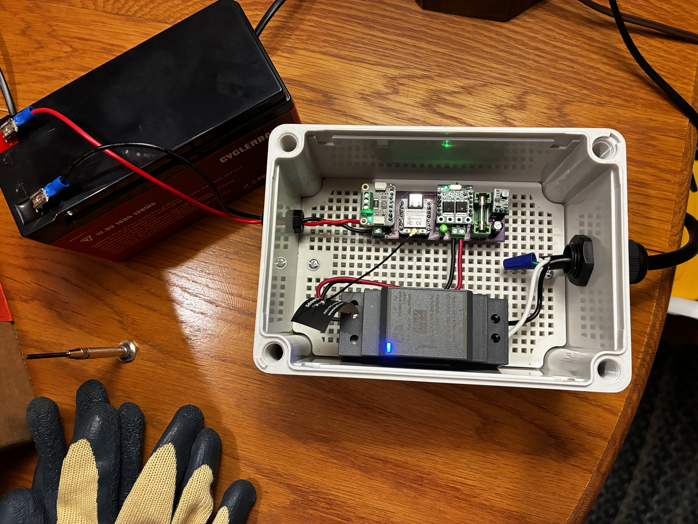
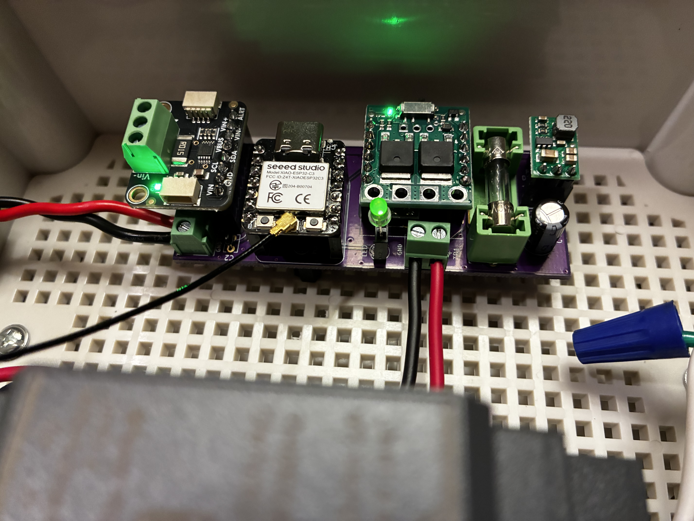

# Does the BMS in a sealed LiFePO4 battery actually balance?

**A small, very cautious charger that holds a 12 V LiFePO4 pack at 14.40 V and logs every milliamp, to find out.**

> **Status (2026-10-31):** built and on the bench. Seven test sessions so far, on one spare pack. The real verdict, a before-and-after capacity test on the UPS's own pack, hasn't been run yet. This page will be updated as results come in.

---

## The question

My [DIY LiFePO4 UPS](../README.md) runs on a sealed 12 V, 10 Ah "drop-in" LiFePO4 battery. The UPS keeps it floating at 13.3 V, which is easy on the battery but never brings the cells up high enough for any balancing to happen.

Between two full discharge tests, the usable capacity the UPS got out of that pack fell from **4.18 Ah to 2.53 Ah** (one test each, measured from full down to the UPS's low-voltage cutoff). The way the voltage sagged suggested the four cells inside are no longer evenly matched.

The usual forum advice is: *every so often, charge it to 14.4–14.6 V and let it sit there, so the BMS can balance the cells.*

The trouble is that this pack is sealed. There are no balance leads, and the label says nothing about balancing. **So does it have a balancer at all?** You can't open it to look, but you can watch it. A balancer works by bleeding a little current off the fullest cell. If I hold the pack at a steady voltage, that bleed should show up as a current that tapers off but never reaches zero. No floor means no balancer, or at least none that's doing anything.

That needs a charger that can hold a voltage for hours, measure fractions of a milliamp, and be trusted to run with nobody watching.

## What it is

- **Mean Well HDR-30-15** DIN-rail supply, trimmed to about 14.4 V. It's a 2 A supply on purpose: even when it's overloaded, it physically can't push more than about 3.6 A, which is under the pack's 5 A charge limit.
- **Pololu MOSFET switch** to turn the charge on and off, and a **Pololu ideal diode** so the battery can never feed back into the supply.
- **Adafruit INA228** current and voltage monitor on a 15 mΩ shunt. It resolves about 20 µA per step, which is fine enough to see a balancer's bleed.
- **Seeed XIAO ESP32-C3** running ESPHome, reporting to Home Assistant once a second.
- A small two-layer carrier board (the purple one, from OSH Park) that ties it all together.

The pack gets its bulk charge on an ordinary hobby charger first. This box only does the long, slow hold at the top.

## Designed for when nobody's watching

The design starts from one question: *what if something fails while I'm not home?* Wi-Fi drops, Home Assistant crashes, the ESP32 hangs, or the supply's voltage drifts high. Every layer below answers one of those failures:

1. The firmware ends the session after a fixed time at voltage.
2. Hard firmware stops for over-voltage, over-current, a sensor dropping out, or the BMS cutting out.
3. If the ESP32 hangs or reboots, the switch falls **off** by itself through its own pull-down resistor.
4. After a power blip or reboot, nothing ever restarts a charge on its own.
5. A plain mechanical countdown timer on the AC plug, with no network, ends everything regardless.
6. The battery's own BMS.
7. A 5 A fuse right at the battery's + terminal, so a short anywhere in the lead or the box is fused at the source.

No alligator clips. The lead ends in insulated quick-disconnects, and polarity is checked before every connection.

## What I've found so far

Seven sessions on a new spare pack of the same model, not the UPS's pack yet:

- **The BMS cut out at 14.31 V**, three times in one evening, with about 1 A flowing. That's well under the 14.6 V on the label. My best guess, not yet proven, is that one cell reaches its limit before the others.
- **At 14.40 V, the current tapered all the way down to about 0.2 mA** over six hours. A typical passive balancer bleeds tens of milliamps. Whatever this pack has, it's bleeding **less than about a third of a milliamp**. At that rate, evening out a 0.25 Ah mismatch would take more than 700 hours, about a month of continuous holding.
- **At 14.50 V, the BMS cut out after 98 seconds** with only 11 mA flowing. The cell that tripped was still charging when it cut, so no meaningful bleed was running on it.
- **An 8-hour hold at about 14.45 V** tapered to around 0.13 mA, with a dozen brief BMS dropouts along the way.

**Where that leaves things:** if this pack has a balancer, I can't see it doing anything at the voltages the label allows. That comes from one pack and short tests. A balancer that only runs at higher charge currents would be invisible to this method. The test that actually settles it is coming next: top off the UPS's own pack, then repeat the full discharge test and see whether the lost capacity comes back.

## Things that bit me

- **The control trace went to the wrong pin.** The board routes the ESP32's output to the Pololu switch's SW pin instead of its ON pin. A bodge wire fixed it, and the next board revision moves the trace.
- **The INA228 breakout's VBUS jumper was open**, so voltage readings came from an unconnected pin until I closed it. Now it's a build step.
- **Saving the board without refilling the ground pour shorted a power net to ground** in the saved file. KiCad's design-rule check on the saved file caught it before anything was ordered.
- **Plugging the battery in with AC on reset the ESP32** every time. Each time it came back with the switch safely off, which is what the design promised, but it's still not how it's meant to be connected.

## About the design doc

[`top-off-charger-design.md`](top-off-charger-design.md) is long. Every number in it is tagged as measured, from a spec sheet, calculated, or inferred. I wrote it with Claude Code as a drafting partner, and it keeps "correction records" for the places where the reasoning went wrong and got caught. Two of those changed the hardware. One moved the bulk charging off this supply, after the datasheet showed that running it in overload is a fault condition, not a charging mode. The other kept the cheaper Pololu switch, after a misread temperature rating was caught.

## Files

| Folder | What's in it |
|---|---|
| [`top-off-charger-design.md`](top-off-charger-design.md) | Full design, test plan, and bench results |
| [`firmware/`](firmware/) | ESPHome YAML for the XIAO ESP32-C3 |
| [`pcb/`](pcb/) | KiCad board file (2-layer, 29.5 × 78 mm) |
| [`assests/`](assests/) | Photos |

Part of the [DIY-LiFePO4-UPS](../README.md) project. Licensed under the repository's [LICENSE](../LICENSE).
